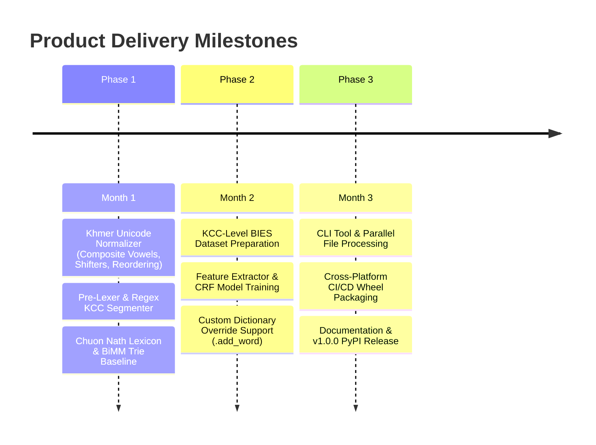

# Product Requirements Document (PRD)

## Project Title: Production-Ready Khmer Word Tokenizer (`khmer-tokenizer`)
- **Document Version**: 1.1.0
- **Status**: Approved / Ready for Implementation
- **Owner**: NLP Core Team
- **Target Release**: Q1 2027
- **Target Audience**: Software Developers, NLP Engineers, Search/RAG Developers, Data Engineers

---

## 1. Executive Summary & Problem Statement

### 1.1 Context
In the Khmer writing system (Cambodia), words are written continuously without spaces between them, while spaces serve only as phrase or sentence pauses. For example, the sentence `"ខ្ញុំស្រឡាញ់ប្រទេសកម្ពុជា"` ("I love Cambodia") is written as a single continuous string of characters. Breaking this continuous stream into discrete lexical words—`["ខ្ញុំ", "ស្រឡាញ់", "ប្រទេស", "កម្ពុជា"]`—is the primary prerequisite for Khmer search engines, text analytics, machine translation, and Large Language Model (LLM) pipelines.

### 1.2 Problem Statement
Existing open-source Khmer tokenization tools suffer from four critical flaws:
1. **Syllable vs. Character Cluster Confusion**: Attempting to segment Khmer syllables via regex causes false merges because syllable-final consonants (such as `ស` in `ប្រទេស`) lack explicit closing markers, or worse, naive splitting severs subscript consonants (`Coeng` `\u17D2`).
2. **Fragility Against Encoding Variants**: Visually identical Khmer words typed with split composite vowels (e.g., typing `\u17C1` + `\u17B6` instead of `\u17C4`) or confused register shifters (`\u17BB` vs. `\u17C9`/`\u17CA`) fail dictionary lookups and degrade model accuracy.
3. **Over-Merging or Under-Segmenting**: Poorly tuned dictionaries either merge distinct lexical words into long phrases or fail on out-of-vocabulary (OOV) proper nouns and modern terms.
4. **Heavy Dependencies**: Requiring large deep-learning frameworks (PyTorch/TensorFlow) for a foundational text-processing step that should run in milliseconds on any CPU.

### 1.3 Solution
Build `khmer-tokenizer`, a fast, lightweight Python library that:
- Normalizes Khmer Unicode into canonical form (merging split vowels and fixing typing order anomalies).
- Segments text into indivisible **Khmer Character Clusters (KCC)** so subscript clusters are never broken.
- Uses a hybrid **Trie Lexicon + Linear-Chain CRF (`BIES` tagging)** engine to accurately reassemble KCCs into standard lexical words (`["ខ្ញុំ", "ស្រឡាញ់", "ប្រទេស", "កម្ពុជា"]`) at $> 25,000\text{ words/sec}$ on a single CPU core.

---

## 2. Product Goals & Non-Goals

### 2.1 Goals
- **G-1 (Lexical Accuracy)**: Achieve $\ge 95.0\%$ Word F1-score and $\ge 97.5\%$ Boundary F1-score on standard Khmer lexical segmentation benchmarks.
- **G-2 (Speed & Efficiency)**: Tokenize $\ge 25,000\text{ words/sec}$ on a single CPU core with $< 45\text{ MB}$ memory footprint.
- **G-3 (Cluster Integrity)**: Guarantee $0\%$ broken Khmer Character Clusters (KCC) or dangling Coeng marks (`U+17D2`).
- **G-4 (Turnkey Developer Experience)**: Provide a one-line Python API (`tokenize("ខ្ញុំស្រឡាញ់ប្រទេសកម្ពុជា")`) and a fast CLI tool.
- **G-5 (Zero Heavy Dependencies)**: Run everywhere on CPU without requiring PyTorch, TensorFlow, or CUDA.

### 2.2 Non-Goals
- **NG-1**: Part-of-Speech (POS) tagging or syntactic dependency parsing.
- **NG-2**: Free-form spelling correction of misspelled root consonants.
- **NG-3**: Sentence translation or sentiment classification.

---

## 3. User Personas & Core Use Cases

### 3.1 Personas
1. **Lina (Application Developer)**: Building a Khmer web/mobile application with search and text processing. Wants `pip install khmer-tokenizer` and `tokenize(text)` to return clean word lists out of the box.
2. **Sokha (Search & Data Engineer)**: Indexing millions of Khmer documents into Elasticsearch. Needs high single-core throughput, custom dictionary injection for domain terms, and zero crashes on noisy social media text.
3. **Virak (AI/LLM Engineer)**: Preprocessing Khmer corpora for RAG chunking and LLM tokenization. Needs reliable word boundaries so chunks do not slice words in half.

### 3.2 User Stories
- **US-1**: As a developer, when I pass `"ខ្ញុំស្រឡាញ់ប្រទេសកម្ពុជា"` into `khmer_tokenizer.tokenize()`, I receive `["ខ្ញុំ", "ស្រឡាញ់", "ប្រទេស", "កម្ពុជា"]` in under $1\text{ ms}$.
- **US-2**: As a data engineer, I can add custom vocabulary (e.g., brand names, technical terms) via `tokenizer.add_word("...")` so they are always preserved as single tokens.
- **US-3**: As a researcher, I can run `khmer-tokenizer --input corpus.txt --output segmented.txt --delimiter " "` to insert spaces between segmented Khmer words across large files.

---

## 4. Functional Requirements (FR)

| ID | Requirement | Priority | Details |
| :--- | :--- | :--- | :--- |
| **FR-1** | **Khmer Unicode Normalization** | P0 (Must Have) | Apply Unicode NFC, merge split composite vowels (`េ+ា` $\rightarrow$ `ោ`, `េ+ី` $\rightarrow$ `ើ`), resolve `\u17BB` vs. `\u17C9`/`\u17CA` shifter collisions, canonically reorder KCC codepoints, and extract `\u200B` cues before stripping. |
| **FR-2** | **KCC Atomic Chunking** | P0 (Must Have) | Deterministically segment Khmer script into Khmer Character Clusters (KCC) via regex (e.g., `["ខ្ញុំ", "ស្រ", "ឡា", "ញ់", "ប្រ", "ទេ", "ស", "ក", "ម្ពុ", "ជា"]`) so subscripts and vowels are never split. |
| **FR-3** | **Mixed Script & Number Lexing** | P0 (Must Have) | Isolate and preserve Latin words, URLs, emails, emojis, Khmer numerals (`០`–`៩`), and Arabic numerals (including decimals like `12.5`) prior to KCC statistical tagging. |
| **FR-4** | **CRF + Trie Boundary Prediction** | P0 (Must Have) | Default hybrid engine combining Chuon Nath Trie match-length features with a Linear-Chain CRF model using `B`, `I`, `E`, `S` tags to reconstruct lexical words. |
| **FR-5** | **Custom Dictionary Injection** | P1 (Should Have) | Allow users to add custom words via `.add_word()`, `.remove_word()`, or `custom_dict_path` that override statistical splits. |
| **FR-6** | **BiMM Fast Fallback Engine** | P1 (Should Have) | Provide a pure dictionary Bi-Directional Maximal Matching engine (`engine="bimm"`) for ultra-low-latency ($> 60,000\text{ words/sec}$) segmentation. |
| **FR-7** | **CLI Batch Interface** | P1 (Should Have) | Command-line utility supporting stdin/stdout streaming, configurable word delimiters, and multi-core file processing. |

---

## 5. Non-Functional Requirements (NFR)

### 5.1 Performance & Latency
- **Latency**: P95 processing time $< 3.0\text{ ms}$ for a 1,000-character paragraph using the default CRF engine on CPU.
- **Throughput**: Single-core throughput $\ge 25,000\text{ words/sec}$ (CRF) and $\ge 60,000\text{ words/sec}$ (BiMM).
- **Startup Time**: Cold-start initialization time $< 200\text{ ms}$ to load the Trie lexicon and CRF weights.

### 5.2 Resource Consumption
- **Memory Footprint**: Working RSS memory $< 45\text{ MB}$ during active inference.
- **Package Size**: Distributed PyPI wheel size $< 12\text{ MB}$ (including default CRF weights and Chuon Nath lexicon).

### 5.3 Reliability & Compatibility
- **Zero-Crash Invariant**: Malformed, incomplete, or repeated Unicode sequences (such as consecutive Coeng marks `\u17D2\u17D2`) must never cause unhandled exceptions or infinite regex backtracking.
- **Thread Safety**: Tokenizer instances must be thread-safe for concurrent web server execution (FastAPI, Gunicorn).
- **Platform Support**: Pre-built wheels for Linux, macOS (Intel & Apple Silicon), and Windows across Python 3.9–3.13.

---

## 6. Verification & Evaluation Framework

### 6.1 Evaluation Metrics
Evaluation is conducted against human-annotated gold-standard Khmer lexical corpora (such as KhmerTreebank and curated Chuon Nath test sets):

1. **Word-Level Precision ($P_w$)**: Ratio of correctly segmented words to total predicted words.
2. **Word-Level Recall ($R_w$)**: Ratio of correctly segmented words to total gold-standard words.
3. **Word-Level F1-Score ($F1_w$)**: Harmonic mean of $P_w$ and $R_w$:
$$\text{F1}_w = 2 \times \frac{P_w \times R_w}{P_w + R_w}$$
4. **Boundary F1-Score ($F1_b$)**: Accuracy of predicting word boundaries between adjacent KCC units.
5. **Broken Cluster Rate**: Percentage of tokens containing severed subscript consonants or detached dependent vowels (Target: $0.0\%$).

### 6.2 Acceptance Criteria
| Engine | Target Word F1 | Target Boundary F1 | Broken Cluster Rate | Minimum Throughput |
| :--- | :--- | :--- | :--- | :--- |
| **BiMM (Trie)** | $\ge 84.0\%$ | $\ge 89.0\%$ | $0.0\%$ | $\ge 60,000\text{ words/s}$ |
| **CRF + Trie (Default)** | $\ge 95.0\%$ | $\ge 97.5\%$ | $0.0\%$ | $\ge 25,000\text{ words/s}$ |

---

## 7. Product Release Roadmap

---

## 8. Risks and Mitigations

| Risk | Impact | Probability | Mitigation Strategy |
| :--- | :--- | :--- | :--- |
| **Inconsistent Khmer Unicode typing** | High | High | Enforce canonical normalization (merging split composite vowels and fixing `\u17BB`/`\u17C9`/`\u17CA` collisions) before KCC segmentation. |
| **Out-of-Vocabulary (OOV) proper nouns** | Medium | High | Combine CRF orthographic features (such as *Bantoc* `\u17CB` and *Tandakhat* `\u17CD` cues) with `.add_word()` custom dictionary injection. |
| **Granularity mismatch in training data** | High | Medium | Standardize training corpora around lexical words matching the Chuon Nath dictionary and common proper nouns (e.g., keeping `ប្រទេស` and `កម្ពុជា` as distinct lexical tokens). |