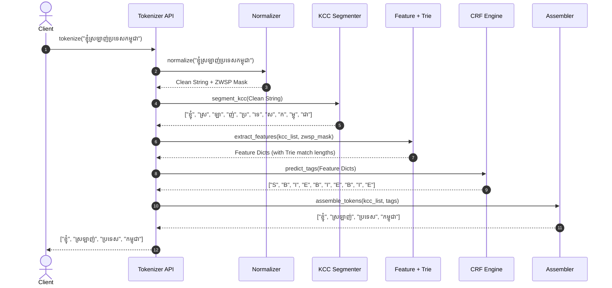

# End-to-End System Architecture: Khmer Word Tokenizer

## 1. System Overview

The **Khmer Word Tokenizer** is a lightweight, production-grade Natural Language Processing (NLP) library designed to segment continuous, unsegmented Khmer script into discrete lexical words. Because written Khmer does not place spaces between words, accurate word segmentation is the foundational prerequisite for search indexing, text analytics, machine translation, and Large Language Model (LLM) preprocessing.

### Target Segmentation Behavior
Given an unsegmented Khmer sentence, the system isolates individual lexical words rather than arbitrary syllables or over-merged phrases:
- **Raw Input**: `"ខ្ញុំស្រឡាញ់ប្រទេសកម្ពុជា"` (I love Cambodia)
- **KCC Atomic Units**: `["ខ្ញុំ", "ស្រ", "ឡា", "ញ់", "ប្រ", "ទេ", "ស", "ក", "ម្ពុ", "ជា"]`
- **BIES Boundary Tags**: `["S", "B", "I", "E", "B", "I", "E", "B", "I", "E"]`
- **Final Token Output**: `["ខ្ញុំ", "ស្រឡាញ់", "ប្រទេស", "កម្ពុជា"]` (I + love + country + Cambodia)

### Architectural Philosophy
- **Linguistically Grounded**: Built around deterministic **Khmer Character Clusters (KCC)** rather than error-prone syllable regexes, guaranteeing that subscript consonants (`Coeng`) and dependent vowels are never severed.
- **Resilient to Encoding Anomalies**: Normalizes inconsistent typing orders, merges split composite vowels, resolves register-shifter collisions, and leverages zero-width spaces (`\u200B`) as boundary cues before stripping them.
- **Hybrid by Design**: Combines a fast Trie dictionary matcher (backed by the Chuon Nath lexicon) with a Linear-Chain Conditional Random Field (CRF) model using a `BIES` (Begin, Inside, End, Single) tagging scheme.
- **High Throughput & Lightweight**: Pure CPU inference engine with zero GPU or heavy deep-learning framework dependencies, targeting $< 3\text{ ms}$ latency per 1,000 characters and $< 45\text{ MB}$ RAM.

---

## 2. Linguistic Fundamentals & Unicode Specifications

Khmer script is an abugida spanning Unicode blocks `U+1780`–`U+17FF` (Khmer) and `U+19E0`–`U+19FF` (Khmer Symbols). Because syllable-final consonants in Khmer carry no explicit closing marker (e.g., `ស` in `ប្រទេស` or `ក` in `លោក`), regular expressions cannot deterministically segment full syllables without false merges. Instead, the true atomic orthographic unit is the **Khmer Character Cluster (KCC)**:

1. **Base Character**: Consonant (`U+1780`–`U+17A2`) or Independent Vowel (`U+17A5`–`U+17B3`).
2. **Robat / Register Shifter**: *Robat* (`U+17CC`), *Muusikatoan* (`U+17C9`), or *Triisap* (`U+17CA`).
3. **Subscript Consonant(s)**: Up to two sequences of *Coeng* (`U+17D2`) followed by a consonant (`U+1780`–`U+17A2`), with subscript `រ` (`\u17D2\u179A`) ordered last.
4. **Dependent Vowel**: Pre-, post-, above-, or below-base vowels (`U+17B6`–`U+17C5`).
5. **Diacritics & Signs**: *Nikahit*, *Reahmuk*, *Bantoc*, *Kakabat*, *Ahsda*, *Samyok Sannya*, *Viriam*, *Atthacan* (`U+17C6`–`U+17C8`, `U+17CB`, `U+17CD`–`U+17D1`, `U+17D3`, `U+17DD`).

### Canonical KCC Normalization Sequence
A valid Khmer Character Cluster is normalized to follow this exact byte sequence prior to segmentation:

$$\text{Base} \rightarrow [\text{Robat}] \rightarrow [\text{Shifter}] \rightarrow [\text{Coeng}_1 + \text{Sub}_1] \rightarrow [\text{Coeng}_2 + \text{Sub}_2] \rightarrow [\text{Dependent Vowel}] \rightarrow [\text{Diacritic/Sign}]$$

### Mandatory Khmer Normalization Rules
Standard Unicode `NFC` does not resolve Khmer-specific orthographic collisions. The normalizer enforces four additional transformations:
1. **Split Composite Vowel Merging**:
   - `\u17C1` (`េ`) + `\u17B6` (`ា`) $\rightarrow$ `\u17C4` (`ោ`)
   - `\u17C1` (`េ`) + `\u17B8` (`ី`) $\rightarrow$ `\u17BE` (`ើ`)
2. **Register Shifter Disambiguation**: Converts mistyped `\u17BB` (`ុ`) into `\u17C9` (`៉`) or `\u17CA` (`៊`) based on the base consonant series when co-occurring with an upper vowel (`\u17B7`, `\u17B8`, `\u17B9`, `\u17BA`, `\u17BE`).
3. **Deprecated Character Cleanup**: Strips invisible inherent vowels (`\u17B4`, `\u17B5`), replaces `\u17A3` with `\u17A2` (`អ`), and replaces `\u17A4` with `\u17A2\u17B6` (`អា`).
4. **ZWSP Cue Extraction**: Records the positions of Zero-Width Spaces (`\u200B`) as explicit human-typed word boundary hints for the feature extractor before removing them from the output string.

---

## 3. End-to-End Data Flow & Pipeline Architecture

```text
                         ┌──────────────────────────────────────────┐
                         │ Raw Input                                 │
                         │ "ខ្ញុំស្រឡាញ់ប្រទេសកម្ពុជា"              │
                         └────────────────────┬─────────────────────┘
                                              │
                                              ▼
             ┌────────────────────────────────────────────────────────┐
             │ 1. Clean and Fix Khmer Text                            │
             │                                                        │
             │ • Put letters into one standard format                 │
             │ • Join split vowels                                    │
             │ • Fix Khmer marks                                      │
             │ • Remove old or invalid characters                     │
             │ • Put Khmer letters in the correct order               │
             └────────────────────┬───────────────────────────────────┘
                                  │
                                  ▼
             ┌────────────────────────────────────────────────────────┐
             │ 2. Find Word Boundaries and Remove Hidden Characters   │
             │                                                        │
             │ • Save the positions of hidden spaces                 │
             │ • Remove hidden characters from the text               │
             │ • Return clean text and saved boundary information     │
             └────────────────────┬───────────────────────────────────┘
                                  │
                                  ▼
             ┌────────────────────────────────────────────────────────┐
             │ 3. Separate Non-Khmer Text                            │
             │                                                        │
             │ • Keep website links and email addresses together       │
             │ • Keep English and mixed-language text together        │
             │ • Keep numbers and decimal numbers together             │
             │ • Keep punctuation and emojis                         │
             │ • Ignore spaces by default; preserve them when needed  │
             └────────────────────┬───────────────────────────────────┘
                                  │
                                  ▼
             ┌────────────────────────────────────────────────────────┐
             │ 4. Split Khmer into Letter Groups                      │
             │                                                        │
             │ • Split Khmer text into small letter groups             │
             │ • Keep Coeng and subscript letters together             │
             │ • Keep vowels and marks with their letters              │
             │ • Example: ប្រទេស → [ប្រ, ទេ, ស]                    │
             └────────────────────┬───────────────────────────────────┘
                                  │
                                  ▼
             ┌────────────────────────────────────────────────────────┐
             │ Khmer Letter Groups                                   │
             │                                                        │
             │ [ខ្ញុំ, ស្រ, ឡា, ញ់, ប្រ, ទេ, ស, ក, ម្ពុ, ជា]        │
             └────────────────────┬───────────────────────────────────┘
                                  │
                                  ▼
             ┌────────────────────────────────────────────────────────┐
             │ 5. Collect Information for Word Splitting              │
             │                                                        │
             │ • Look at nearby letter groups                         │
             │ • Compare one, two, and three groups                   │
             │ • Check letters, marks, and spelling patterns           │
             │ • Check matching words in the dictionary               │
             │ • Check saved word-boundary positions                  │
             └────────────────────┬───────────────────────────────────┘
                                  │
                                  ▼
             ┌──────────────────── Choose a Word Splitter ────────────┐
             │                                                        │
             │  ┌──────────────────────────┐  ┌─────────────────────┐ │
             │  │ Main method: CRF         │  │ Fast method: BiMM   │ │
             │  │                          │  │                     │ │
             │  │ • Find word boundaries   │  │ • Match from both   │ │
             │  │ • Uses the dictionary   │  │   directions         │ │
             │  │ • Uses only the CPU     │  │ • Uses dictionary    │ │
             │  └──────────────┬───────────┘  └──────────┬──────────┘ │
             │                 └──────────────┬─────────┘            │
             └────────────────────────────────┼──────────────────────┘
                                              │
                                              ▼
             ┌────────────────────────────────────────────────────────┐
             │ 6. Apply User Dictionary                                │
             │                                                        │
             │ • Add words from add_word()                            │
             │ • Add words from a custom dictionary file              │
             │ • Keep matching words together                          │
             └────────────────────┬───────────────────────────────────┘
                                  │
                                  ▼
             ┌────────────────────────────────────────────────────────┐
             │ Word Boundary Labels                                  │
             │                                                        │
             │ [S, B, I, E, B, I, E, B, I, E]                       │
             └────────────────────┬───────────────────────────────────┘
                                  │
                                  ▼
             ┌────────────────────────────────────────────────────────┐
             │ 7. Build the Final Words                               │
             │                                                        │
             │ • Join letter groups into words                        │
             │ • Keep single groups as one word                       │
             │ • Keep English, numbers, and symbols unchanged         │
             └────────────────────┬───────────────────────────────────┘
                                  │
                                  ▼
             ┌──────────────────────────────────────────┐
             │ Final Token List                         │
             │                                          │
             │ [ខ្ញុំ, ស្រឡាញ់, ប្រទេស, កម្ពុជា]       │
             └──────────────────────────────────────────┘
```

---

## 4. Pipeline Components

### Component 1: Khmer Unicode Normalizer (`khmer_tokenizer.normalizer`)
- **Composite & Shifter Resolution**: Merges split two-part vowels and resolves `\u17BB` vs. `\u17C9`/`\u17CA` ambiguity.
- **Canonical Reordering**: Deterministic table-based sorter that orders subscripts, shifters, vowels, and diacritics inside each cluster.
- **Boundary Cue Extraction**: Extracts `\u200B` (ZWSP) indices into a boolean mask before stripping zero-width characters (`\u200B`, `\u200C`, `\u200D`, `\uFEFF`).

### Component 2: Pre-Lexer & KCC Segmenter (`khmer_tokenizer.segmenter`)
- **Pre-Lexer**: Identifies non-Khmer tokens (Latin words, URLs, emails, Arabic numerals, Khmer numerals `U+17E0`–`U+17E9`, decimals like `12.5`, and Khmer punctuation `U+17D4`–`U+17DA`) as atomic passthrough spans so they do not pollute statistical Khmer boundary detection.
- **KCC Regex Chunker**: Segments contiguous Khmer spans into indivisible Khmer Character Clusters (KCC). For example, `ប្រទេស` is segmented into `["ប្រ", "ទេ", "ស"]`, guaranteeing that `ប្រ` (`ប` + `\u17D2` + `រ`) is never split.

### Component 3: Feature Extractor & Lexicon Trie (`khmer_tokenizer.features`)
For each KCC $C_i$ in a sequence, features are extracted across a sliding window $W \in [-3, +3]$:
- **KCC N-Grams**: Unigrams $C_{i-3..i+3}$, bigrams $(C_{i-1}, C_i)$, and trigrams $(C_{i-1}, C_i, C_{i+1})$.
- **Orthographic Indicators**: Base consonant series, presence of subscript, presence of dependent vowel, and closing signs (*Bantoc* `\u17CB` or *Tandakhat* `\u17CD`, which strongly indicate end-of-word or end-of-syllable consonants like `ញ់` in `ស្រឡាញ់`).
- **Lexicon Trie Match Lengths**: Queries the bundled Chuon Nath Trie to compute the longest forward word match starting at $C_i$, continuing through $C_i$, or ending at $C_i$ (measured in KCC length: $1, 2, 3, \ge 4$).
- **ZWSP Indicator**: Boolean feature indicating if a zero-width space preceded $C_i$ in the raw text.

### Component 4: Sequence Boundary Predictor (`khmer_tokenizer.models`)
Supports two lightweight CPU engines with custom dictionary enforcement:
1. **Linear-Chain CRF (`crfsuite`)** *(Default)*:
   - Formulates word segmentation as 4-class sequence labeling over KCCs:
     - `B`: Beginning KCC of a multi-cluster word (e.g., `ស្រ` in `ស្រឡាញ់`).
     - `I`: Inside KCC of a multi-cluster word (e.g., `ឡា` in `ស្រឡាញ់`).
     - `E`: Ending KCC of a multi-cluster word (e.g., `ញ់` in `ស្រឡាញ់`).
     - `S`: Single-KCC word (e.g., `ខ្ញុំ`).
   - Decodes the globally optimal tag sequence via Viterbi decoding in C (`python-crfsuite`).
2. **Bi-Directional Maximal Matching (`BiMM`)** *(Ultra-Fast Fallback)*:
   - Runs Forward Maximal Matching (FMM) and Backward Maximal Matching (BMM) over the KCC stream using the Trie lexicon.
   - Resolves disagreements by selecting the segmentation with the fewest total words and fewest single-KCC unknown tokens.
3. **Custom Dictionary Override**:
   - Words registered via `.add_word()` or `custom_dict_path` take precedence over statistical predictions by locking matching KCC spans into `B-I-E` or `S` tags.

### Component 5: Token Assembler (`khmer_tokenizer.assembler`)
- Iterates through the `(KCC, Tag)` pairs to join `B` + `I`* + `E` sequences into complete lexical words and emit `S` clusters directly.
- Preserves non-Khmer tokens (numbers, punctuation, Latin words) and optional whitespace tokens if `keep_whitespace=True`.

---

## 5. Execution Sequence Diagram



---

## 6. Detailed File Layout & Modular Organization

```text
khmer-tokenizer/
├── .github/
│   └── workflows/
│       ├── test.yml                   # CI: Automated pytest, ruff, and mypy checks
│       └── publish.yml                # CD: PyPI wheel packaging & release automation
├── docs/
│   ├── ARCHITECTURE.md                # System architecture document (this file)
│   ├── PRD.md                         # Product requirements document
│   └── API_REFERENCE.md               # Public class and function documentation
├── configs/
│   └── normalizer_rules.json          # Composite vowel and canonical ordering tables
├── data/
│   ├── dictionaries/
│   │   ├── chuon_nath_dict.txt        # Chuon Nath base lexical dictionary
│   └── corpora/
│       ├── raw/                       # Unprocessed segmented Khmer text dumps
│       └── processed/                 # KCC-level BIES format train/dev/test splits
├── khmer_tokenizer/                   # Main library source code
│   ├── __init__.py                    # Public exports: tokenize(), KhmerTokenizer
│   ├── constants.py                   # Unicode ranges, KCC regexes, BIES tags
│   ├── exceptions.py                  # Custom library exceptions
│   ├── normalizer/
│   │   ├── __init__.py
│   │   ├── cleaner.py                 # ZWSP cue extraction & control char removal
│   │   ├── vowels.py                  # Split composite vowel & shifter resolution
│   │   └── reorder.py                 # Khmer KCC canonical reordering
│   ├── segmenter/
│   │   ├── __init__.py
│   │   ├── lexer.py                   # Pre-lexer for numbers, Latin, URLs, punctuation
│   │   └── kcc.py                     # Deterministic regex-based KCC chunker
│   ├── models/
│   │   ├── __init__.py
│   │   ├── base.py                    # BaseTokenizer abstract base class
│   │   ├── trie.py                    # Prefix Trie for fast lexicon & custom dict lookup
│   │   ├── bimm.py                    # Bi-Directional Maximal Matching engine
│   │   └── crf/
│   │       ├── __init__.py
│   │       ├── features.py            # KCC window + Trie feature extraction
│   │       └── crf_engine.py          # python-crfsuite wrapper + custom dict overrides
│   ├── postprocessor/
│   │   ├── __init__.py
│   │   └── assembler.py               # BIES tag-to-word reconstructor
│   └── cli.py                         # Command-line interface for file/stream processing
├── pretrained/
│   ├── crf_khmer_base.crfsuite        # Pretrained lightweight CRF model weights
│   └── model_metadata.json            # Model version, training date, F1 metrics
├── scripts/
│   ├── benchmark.py                   # Speed and memory benchmarking script
│   ├── build_kcc_dataset.py           # Convert word-segmented corpus to KCC BIES tags
│   └── tokenize_text.py               # Tokenize text from the command line
├── tests/
│   ├── __init__.py
│   ├── test_normalizer.py             # Unit tests for composite vowels & reordering
│   ├── test_kcc.py                    # Tests for KCC segmentation & zero broken Coeng
│   ├── test_bimm.py                   # Unit tests for Trie and BiMM matching
│   ├── test_crf_tokenizer.py          # End-to-end tests (e.g., ខ្ញុំស្រឡាញ់ប្រទេសកម្ពុជា)
│   └── test_edge_cases.py             # Tests for mixed script, numbers, URLs, emojis
├── pyproject.toml                     # PEP 621 build configuration and dependencies
├── LICENSE                            # Apache 2.0 License
└── README.md                          # Quickstart guide & installation instructions
```

---

## 7. Performance Targets & Deployment Strategy

### Hardware & Latency Targets
| Metric | CRF Engine (Default) | BiMM Trie Engine (Fast Mode) |
| :--- | :--- | :--- |
| **P95 Latency (1K chars)** | $< 3\text{ ms}$ | $< 0.8\text{ ms}$ |
| **Throughput (Single Core)** | $> 25,000\text{ words/sec}$ | $> 60,000\text{ words/sec}$ |
| **RAM Footprint** | $< 45\text{ MB}$ | $< 25\text{ MB}$ |
| **GPU Dependency** | None (Pure CPU) | None (Pure CPU) |

### Deployment Profiles
1. **Embedded Python Library**: `pip install khmer-tokenizer` with pre-compiled binary wheels containing the default CRF weights and Chuon Nath lexicon.
2. **CLI Batch Processor**: Built-in multiprocessing CLI (`khmer-tokenizer -i input.txt -o output.txt`) for tokenizing large text corpora.